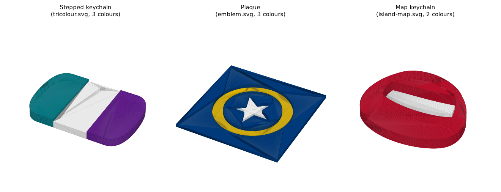

# svg-keychain-3mf

Turn a flat-colour SVG — a flag map, a logo, a simple badge — into a **multi-colour 3MF** you can open in
Bambu Studio and print with an AMS: every colour becomes its own part, already assigned to its own filament slot.

**Free for personal, hobby, educational and non-profit use. Commercial use — including selling items made with
it — needs a licence from the author.** See [Licence](#licence).



## What it does

- Reads each fill colour in the SVG as a separate printable zone (strokes become zones too).
- Builds **keychains** (with a key-ring hole), **plaques** and **fridge magnets**. Magnets get hidden pockets for
  5 mm × 2 mm disc magnets: add a pause at Z = 2.46 mm in Bambu Studio, drop the magnets in, and resume.
- **Stepped relief** by default: each colour finishes at its own height so the design reads in 3D. `--flat` turns this off.
- **Double-sided keychains** (`--double-sided`) and an optional **backing plate** in a colour of your choice.
  Keychains whose design has separate islands get a marine-blue (`#0f4c81`) backing plate automatically unless you
  set `--base-colour`.
- Cleans up for printing: merges near-identical colours and removes specks too small for your nozzle (0.4 mm or
  0.2 mm). Keychains also drop slivers and fill pin-holes too thin to print, and drop islands that are too far away
  to join the keychain as one piece.
- Writes a 3MF with one object per colour, extruders 1…N and the filament colours pre-filled.
- Can re-read a 3MF it produced to rebuild it as a different output (other Bambu Studio projects may work but are untested).
- Desktop app (Tkinter) and a command line. Works offline; no account, no telemetry.

## Install

Needs Python 3.11 or newer.

**One command** (with [pipx](https://pipx.pypa.io/)):

```bash
pipx install "svg-keychain-3mf[render] @ git+https://github.com/hassanitani6/svg-keychain-3mf"
svg-keychain doctor
```

**From a clone** (with [uv](https://docs.astral.sh/uv/)):

```bash
git clone https://github.com/hassanitani6/svg-keychain-3mf
cd svg-keychain-3mf
uv sync --extra render      # or: pip install ".[render]"
uv run svg-keychain doctor  # checks what is installed
```

The `render` extra adds a more faithful SVG reader (handles clipping, masks and overlapping shapes). It needs the
Cairo library on your system: `brew install cairo` on macOS, `sudo apt install libcairo2` on Debian/Ubuntu. Without it
the tool still works using its built-in path parser — `doctor` tells you which reader is active. On Windows,
expect the path parser unless you have installed Cairo yourself; the automated Windows tests use the path parser.

## Updating

Installed with pipx: run the same install command with `--force`:

```bash
pipx install --force "svg-keychain-3mf[render] @ git+https://github.com/hassanitani6/svg-keychain-3mf"
```

From a clone: `git pull` then `uv sync --extra render`. `svg-keychain --version` shows what you have; changes are
listed in [CHANGELOG.md](CHANGELOG.md).

## Quick start

Desktop app:

```bash
uv run svg-keychain
```

Command line:

```bash
uv run svg-keychain generate examples/tricolour.svg --outputs keychain,plaque,magnet -o out/
# out/tricolour_keychain.3mf   3 colour parts
# out/tricolour_plaque.3mf     3 colour parts
# out/tricolour_magnet.3mf     3 colour parts
```

Open the 3MF in Bambu Studio. Check that each part is on the filament you want, slice, and print.

Useful options (`svg-keychain generate --help` for all):

| Option | Default | Meaning |
|---|---|---|
| `--size` | 60 (keychain, magnet), 100 (plaque) | Longest side in mm |
| `--thickness` | 5 | Total thickness in mm for plaques and magnets (keychains use a fixed 4–5.5 mm relief) |
| `--hole` | 3 | Key-ring hole diameter in mm |
| `--nozzle` | 0.4 | 0.2 keeps finer detail |
| `--flat` | off | All colours the same height |
| `--double-sided` | off | Keychain reads on both faces |
| `--base-colour '#0f4c81'` | none | Adds a backing plate |
| `--path-parser` | off | Skip the Cairo reader |
| `--overwrite` | off | Replace 3MF files that already exist (the input is never replaced) |

## Examples

`examples/` holds three synthetic SVGs (public domain, CC0) used in the picture above and in the tests.

## Limitations

- **Flat colours work best.** Gradients and filters are flattened to the nearest solid colours; embedded photos are
  not converted. Convert text to paths first for reliable results (Inkscape: *Path → Object to Path*): the path
  parser ignores text, and the Cairo reader depends on the fonts installed on your computer.
- **Printer profile.** The project file is set up for a Bambu Lab A1 with a 0.4 mm nozzle and Bambu PLA Basic. On
  another printer, Bambu Studio may offer to switch profiles: accept, then check each part's filament slot.
- **Made for Bambu Studio.** The 3MF includes Bambu Studio project metadata (it identifies itself as a Bambu Studio
  project so colours and extruders load). Other slicers may open the geometry without the colour assignments; this
  has not been tested.
- **One-piece keychains.** Islands that cannot be joined to the main shape are dropped from keychains. Use a plaque
  with `--base-colour` if you need every island.
- Tested on macOS (Apple silicon) with Python 3.12. Linux and Windows run in CI but have not been tried by hand;
  the Cairo reader is the part most likely to need setup on Windows.
- Use designs you have the right to print. Many flag-map SVGs on Wikimedia Commons are public domain or
  CC-licensed — check each file's page.

## Troubleshooting

| Symptom | Try |
|---|---|
| `no coloured regions found` | The SVG has no fills. Convert strokes/text to paths and save as plain SVG. |
| `doctor` says *path parser only* | Install Cairo (see Install) or point `SVG_KEYCHAIN_LIBCAIRO` at `libcairo` directly. |
| Shapes overlap or colours look wrong | Remove `--path-parser`, or install the `render` extra. |
| `magnet skipped` | The outline is too small or narrow for the 5 mm pockets (or nothing was left after clean-up); increase `--size`. |
| App window does not open on Linux | Install Tk: `sudo apt install python3-tk`. `svg-keychain generate` works without it. |
| The app stopped with an error | Python errors are saved to `svg-keychain-3mf_error.log` in your home folder (check it before attaching it to an issue). A hard crash may leave no log. |

## Costs and privacy

The tool is free and runs entirely on your computer. It does not upload your designs, check for updates or collect
usage data, and it does not fetch images or files that an SVG links to (there is a test for this).

GitHub issues are public. The issue form asks for `svg-keychain doctor` output, which leaves out your user name and
home folder — check it before pasting. The maintainer may use an AI assistant (Anthropic's Claude) on their own
computer to help read a report; that only happens when they choose to run it. Before anything is sent, the tool
tries to remove email addresses, North American phone numbers, home-folder paths and common access tokens — this is
pattern-based and not guaranteed, so please don't post private details. Nothing runs automatically when you file an
issue.

## Contributing

See [CONTRIBUTING.md](CONTRIBUTING.md). Security problems: see [SECURITY.md](SECURITY.md).

## Licence

[PolyForm Noncommercial 1.0.0](LICENSE): you may use, copy and change it for any noncommercial purpose — personal
projects, hobbies, study, research, schools, charities and other non-profits. Using it in a business, or to make
things you sell, needs a commercial licence: open an issue titled "Commercial licence" and the author will get in
touch. This is a source-available licence, not an OSI open-source licence. Versions before 0.1.1 were released
under the MIT licence.

Bambu Lab and Bambu Studio are trademarks of their owner; this project is not
affiliated with or endorsed by them.
